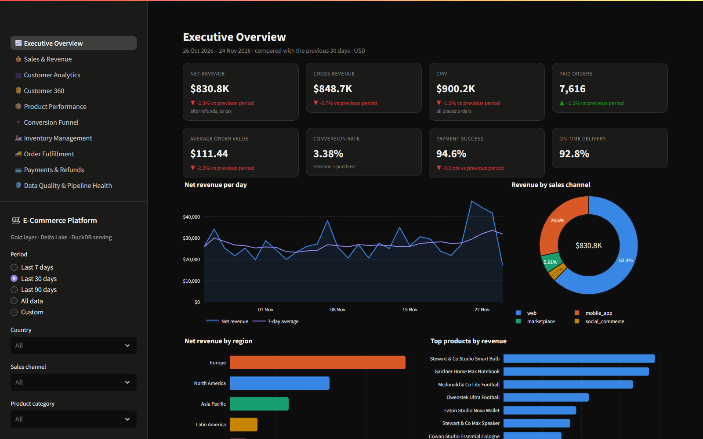
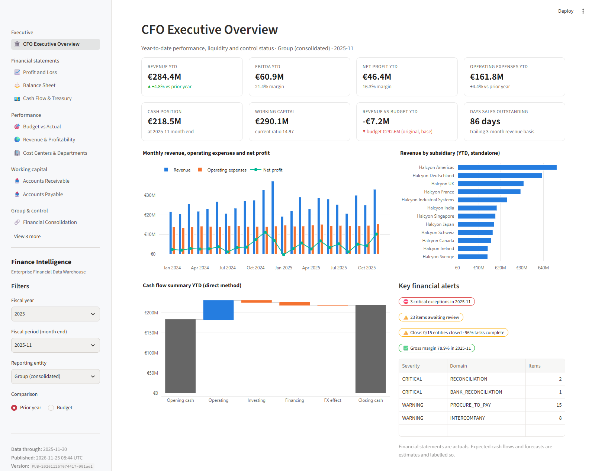

# 👋 Welcome to my GitHub profile

## Software Engineer | Data Engineer

Passionate about building scalable software, distributed systems, reliable data pipelines, and modern data platforms.

### 🚀 Technical Skills

- **Languages:** Java, Python, SQL, TypeScript, JavaScript
- **Backend:** Spring Boot, FastAPI, Django, REST APIs
- **Data Engineering:** Apache Spark, PySpark, Kafka, Airflow, dbt
- **Data Architecture:** ETL/ELT, Delta Lake, Data Lakehouse, Data Warehouse
- **Databases:** PostgreSQL, MySQL, MongoDB, Redis, Snowflake
- **Cloud:** AWS, Azure, GCP
- **DevOps:** Docker, Kubernetes, Terraform, GitHub Actions, CI/CD
- **Architecture:** Microservices, Event-Driven Architecture, Distributed Systems

## 📂 Featured Projects

<table>
<tr>
<td width="50%" valign="top">

<h3>Real-Time E-Commerce Data Platform</h3>

End-to-end streaming data platform featuring real-time event processing, lakehouse architecture, Customer 360 analytics, and automated data pipelines.

<b>Technologies:</b> Python, Kafka, PySpark, Delta Lake, Airflow, SQL

<a href="https://github.com/Marcel-Kaczmarek-data/real-time-ecommerce-data-platform">View Repository →</a>

</td>
<td width="50%" valign="top">

<h3>Enterprise Financial Data Warehouse</h3>

Enterprise financial data warehouse featuring incremental ingestion, multi-currency consolidation, financial reconciliation, and an interactive CFO dashboard.

<b>Technologies:</b> Python, SQL, dbt, Streamlit, ETL/ELT

<a href="https://github.com/Marcel-Kaczmarek-data/enterprise-financial-data-warehouse">View Repository →</a>

</td>
</tr>
</table>

### 📫 Connect with me

[LinkedIn](https://www.linkedin.com/in/marcel-kaczmarek-946398442)
